

  <!-- Attio-Inspired Architectural Hero (Clickable -> Portfolio) -->
  

    <a href="https://code.amrimarihotjati.workers.dev/"><picture><source media="(prefers-color-scheme: dark)" srcset="./assets/hero-dark.svg" /><source media="(prefers-color-scheme: light)" srcset="./assets/hero-light.svg" /></picture></a>
  

  <!-- Minimalist Monochrome Action Pills -->
  

    &nbsp;
    &nbsp;
    &nbsp;
    &nbsp;
    
  

  <!-- Section 01 Header -->
  

    <a href="https://code.amrimarihotjati.workers.dev/"><picture><source media="(prefers-color-scheme: dark)" srcset="./assets/header-skills-dark.svg" /><source media="(prefers-color-scheme: light)" srcset="./assets/header-skills-light.svg" />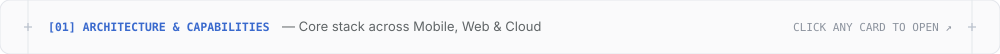</picture></a>
  

  <!-- Section 01: 3 Individual Selectable Capability Bento Cards -->
  

    <a href="https://github.com/amrimarihotjati/Jual-Beli-Mobil-Bekas"><picture><source media="(prefers-color-scheme: dark)" srcset="./assets/skill-mobile-dark.svg" /><source media="(prefers-color-scheme: light)" srcset="./assets/skill-mobile-light.svg" />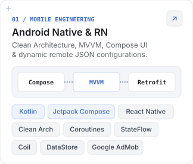</picture></a>
    <a href="https://github.com/amrimarihotjati/Circle-Project"><picture><source media="(prefers-color-scheme: dark)" srcset="./assets/skill-web-dark.svg" /><source media="(prefers-color-scheme: light)" srcset="./assets/skill-web-light.svg" />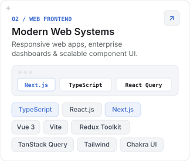</picture></a>
    <a href="https://code.amrimarihotjati.workers.dev/"><picture><source media="(prefers-color-scheme: dark)" srcset="./assets/skill-cloud-dark.svg" /><source media="(prefers-color-scheme: light)" srcset="./assets/skill-cloud-light.svg" />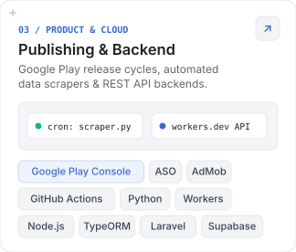</picture></a>
  

  <!-- Section 02 Header -->
  

    <a href="https://github.com/amrimarihotjati?tab=repositories"><picture><source media="(prefers-color-scheme: dark)" srcset="./assets/header-projects-dark.svg" /><source media="(prefers-color-scheme: light)" srcset="./assets/header-projects-light.svg" />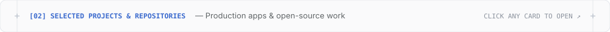</picture></a>
  

  <!-- Section 02: 8 Individual Selectable Project Bento Cards (2-Column Grid) -->
  

    <a href="https://play.google.com/store/apps/details?id=us.screener.saham&gl=us"><picture><source media="(prefers-color-scheme: dark)" srcset="./assets/proj-screener-dark.svg" /><source media="(prefers-color-scheme: light)" srcset="./assets/proj-screener-light.svg" />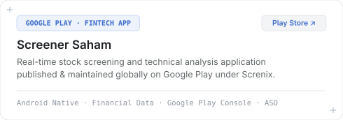</picture></a>
    <a href="https://github.com/amrimarihotjati/Jual-Beli-Mobil-Bekas"><picture><source media="(prefers-color-scheme: dark)" srcset="./assets/proj-mobil-dark.svg" /><source media="(prefers-color-scheme: light)" srcset="./assets/proj-mobil-light.svg" />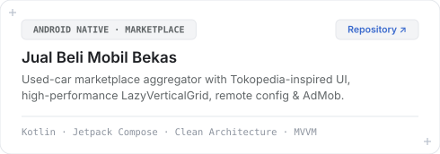</picture></a>
  

  

    <a href="https://github.com/amrimarihotjati/harga-emas"><picture><source media="(prefers-color-scheme: dark)" srcset="./assets/proj-emas-dark.svg" /><source media="(prefers-color-scheme: light)" srcset="./assets/proj-emas-light.svg" />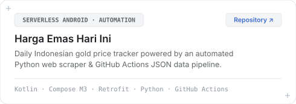</picture></a>
    <a href="https://github.com/amrimarihotjati/dubai-mallmaps-antigravity"><picture><source media="(prefers-color-scheme: dark)" srcset="./assets/proj-dubai-dark.svg" /><source media="(prefers-color-scheme: light)" srcset="./assets/proj-dubai-light.svg" />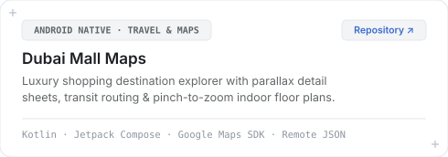</picture></a>
  

  

    <a href="https://infrastrukturdaerah.pu.go.id/sicalmers"><picture><source media="(prefers-color-scheme: dark)" srcset="./assets/proj-sicalmers-dark.svg" /><source media="(prefers-color-scheme: light)" srcset="./assets/proj-sicalmers-light.svg" />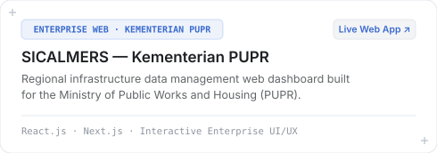</picture></a>
    <a href="https://play.google.com/store/apps/details?id=us.personal.budget.loan.tracker&gl=us"><picture><source media="(prefers-color-scheme: dark)" srcset="./assets/proj-loanflow-dark.svg" /><source media="(prefers-color-scheme: light)" srcset="./assets/proj-loanflow-light.svg" />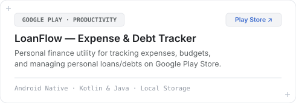</picture></a>
  

  

    <a href="https://github.com/amrimarihotjati/PempekKito-Project"><picture><source media="(prefers-color-scheme: dark)" srcset="./assets/proj-pempekkito-dark.svg" /><source media="(prefers-color-scheme: light)" srcset="./assets/proj-pempekkito-light.svg" />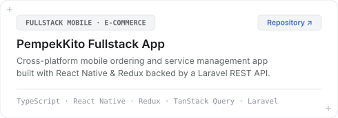</picture></a>
    <a href="https://github.com/amrimarihotjati/Circle-Project"><picture><source media="(prefers-color-scheme: dark)" srcset="./assets/proj-circle-dark.svg" /><source media="(prefers-color-scheme: light)" srcset="./assets/proj-circle-light.svg" />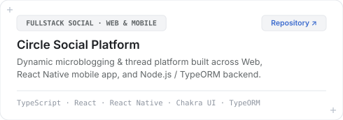</picture></a>
  

   

  <!-- Clean Direct Repository Index -->
  
    <b>More Repositories:</b> &nbsp;
    <a href="https://github.com/amrimarihotjati/my-apps-api">my-apps-api</a> ·
    <a href="https://github.com/amrimarihotjati/landing-page-gravity">landing-page-gravity</a> ·
    <a href="https://github.com/amrimarihotjati/aicon-test-fe">aicon-test-fe</a> ·
    <a href="https://github.com/amrimarihotjati/Laravel-BE-PempekKito">Laravel-BE-PempekKito</a> ·
    <a href="https://github.com/amrimarihotjati/FE-Circle-Project">FE-Circle-Project</a> ·
    <a href="https://github.com/amrimarihotjati/circle-project-react-native">circle-project-react-native</a> ·
    <a href="https://github.com/amrimarihotjati/BE-Circle-Project">BE-Circle-Project</a>
  

