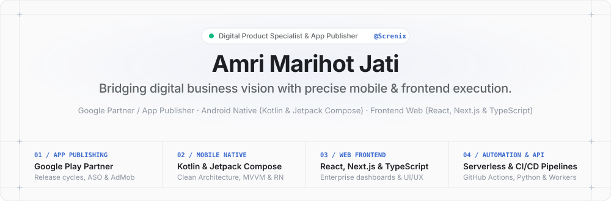
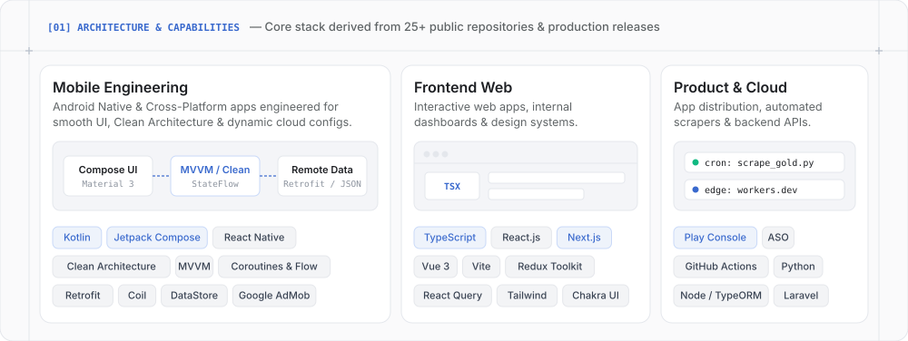
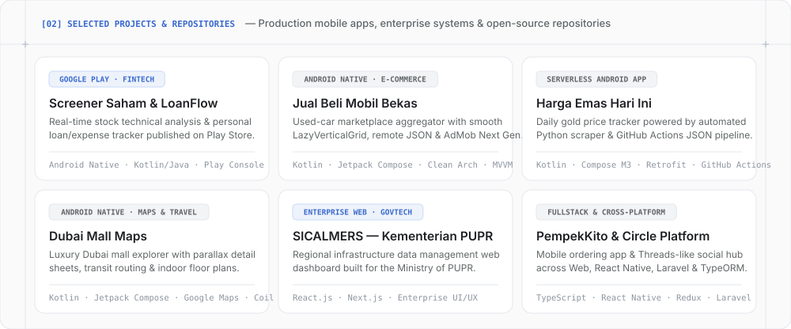

  <!-- Attio-Inspired Architectural Hero (Auto Light/Dark Mode) -->
  <a href="https://code.amrimarihotjati.workers.dev/">
    <picture>
      <source media="(prefers-color-scheme: dark)" srcset="./assets/hero-dark.svg" />
      <source media="(prefers-color-scheme: light)" srcset="./assets/hero-light.svg" />
      
    </picture>
  </a>

   

  <!-- Minimalist Monochrome Action Pills -->
  

    
    &nbsp;
    
    &nbsp;
    
    &nbsp;
    
    &nbsp;
    
  

  <!-- Section 01: Bento Grid — Architecture & Capabilities -->
  <picture>
    <source media="(prefers-color-scheme: dark)" srcset="./assets/bento-skills-dark.svg" />
    <source media="(prefers-color-scheme: light)" srcset="./assets/bento-skills-light.svg" />
    
  </picture>

    

  <!-- Section 02: Bento Grid — Selected Projects & Production Apps -->
  <picture>
    <source media="(prefers-color-scheme: dark)" srcset="./assets/bento-projects-dark.svg" />
    <source media="(prefers-color-scheme: light)" srcset="./assets/bento-projects-light.svg" />
    
  </picture>

   

  <!-- Clean Direct Repository Index -->
  
    <b>Quick Repository Index:</b> &nbsp;
    <a href="https://github.com/amrimarihotjati/Jual-Beli-Mobil-Bekas">Jual-Beli-Mobil-Bekas</a> ·
    <a href="https://github.com/amrimarihotjati/harga-emas">harga-emas</a> ·
    <a href="https://github.com/amrimarihotjati/dubai-mallmaps-antigravity">dubai-mallmaps-antigravity</a> ·
    <a href="https://github.com/amrimarihotjati/my-apps-api">my-apps-api</a> ·
    <a href="https://github.com/amrimarihotjati/PempekKito-Project">PempekKito-Project</a> ·
    <a href="https://github.com/amrimarihotjati/Circle-Project">Circle-Project</a> ·
    <a href="https://github.com/amrimarihotjati/landing-page-gravity">landing-page-gravity</a> ·
    <a href="https://github.com/amrimarihotjati/aicon-test-fe">aicon-test-fe</a>
  

